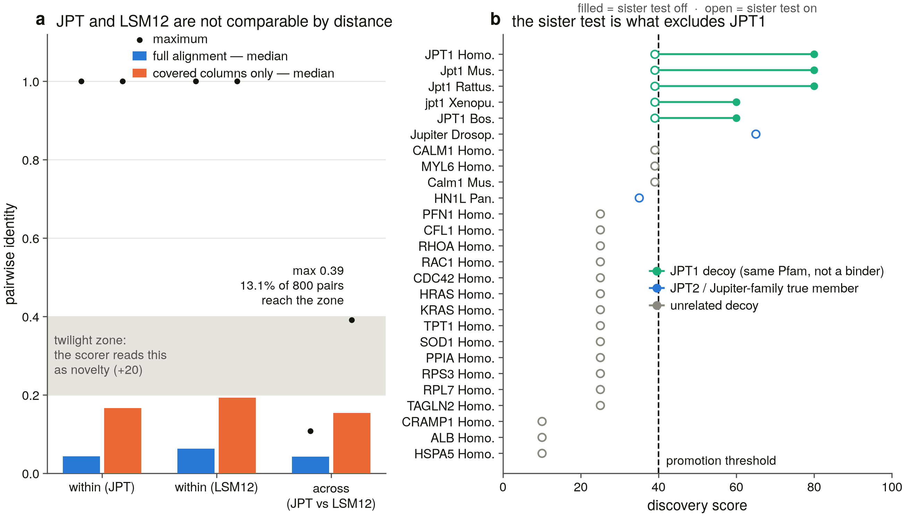

# naadp_binder_genes — a publication-grade census of the NAADP-binding proteins

> **Status board and findings are at the bottom.** This README is the
> state-of-the-project summary and is refreshed at the end of every session.

**Status: S1 complete — the scorer is a validated instrument, per
partition, and we know exactly what it cannot do.** S0 verified the
literature baseline (19 references) and re-derived every database number.
S1 installed the toolchain, implemented the two-family partition in code,
and benchmarked the discovery scorer against 17 true members and 58 decoys
led by JPT1 — the paralog that carries JPT2's signature and does not bind
NAADP. **Without the labelled-bait distance test, 5/5 JPT1 decoys are
promoted; with it, 0/5.** Recall on unnamed true members is 12/15, rising
to **15/15** once the sequence-signature fallback is attached — which is
what makes it safe to stop treating "no Pfam" as "not in the family".
The next session runs **S2**.

## What this is

**Subject: JPT2 (~190 aa) and LSM12 (~195 aa)** — the small accessory
proteins that bind NAADP, the most potent Ca²⁺-mobilising second messenger
known, and confer NAADP sensitivity onto the two-pore channels.

For **more than a quarter of a century** NAADP's receptor was unidentified —
26 years from the naming of the messenger in 1995 to the identification of
its binding proteins in 2021. Two-pore channels were proposed and widely
accepted, then shown not to bind NAADP directly. These two proteins are what
actually binds it. The channel half of the story is the sibling project,
[`../naadpr_genes`](../naadpr_genes). Citations for all of this:
[`docs/naadp_binder_review_2026.md`](docs/naadp_binder_review_2026.md).

## Two things make this project unusual

**1. It is two unrelated families, not one.** JPT2 and LSM12 share a ligand
and nothing else — no common domain, no detectable similarity, no alignable
ancestry. The pipeline assumes one family whose members are mutually
comparable, so every distance, tree and novelty score has to be computed
*within* a partition and never across. Run the `jpt` and `lsm12` presets
separately; **S1 made a mixed run impossible** — the scorer raises rather
than returning a cross-family number.

**2. The decoy is inside the family, and no domain separates it.**

| | Length | Pfam | Binds NAADP? |
|---|---|---|---|
| **JPT2** (Q9H910) | 190 aa | PF17054 | **yes** |
| **JPT1** (Q9UK76) | 154 aa | **PF17054** | **no** |
| **LSM12** (Q3MHD2) | 195 aa | PF09793, PF21166 | **yes** |

JPT1 carries JPT2's exact signature at nearly its size. Where the sibling
projects could lean on a 2,000 aa separation between a real family member
and its decoy, this one cannot. **A domain hit here is a family call, never
a function call** — nothing in this repo writes "NAADP binder" on the
strength of a Pfam signature.

S0 confirmed the premise against a direct published test and put a number on
the difficulty: JPT1 shows **no measurable NAADP binding** (against 1.09 nM
for JPT2 and 0.703 nM for LSM12), and JPT1 and JPT2 are **~40 % identical**
[PMID:37607218]. That 40 % is the gap every method here has to see across.

## Quickstart

```bash
pip install -r requirements.txt          # biopython, requests

python run.py                            # GUI
python run.py --headless --preset jpt --save-results     # one partition
python run.py --headless --preset lsm12 --save-results   # the other

python3 scripts/dashboard.py --open
python -m src.utils.data_root --require  # exit 1 = drive not attached
```

## The science

Re-derived live 2026-08-18 by `scripts/s0_db_snapshot.py`
(UniProt, `gene_exact` × `taxonomy_id`, screened by length and Pfam — never
by rank). Full table with provenance:
[`results/s0_baseline/report.md`](results/s0_baseline/report.md).

| Species | JPT2 | LSM12 | JPT1 (decoy) |
|---|---|---|---|
| human | Q9H910 (190 aa) | Q3MHD2 (195 aa) | Q9UK76 (154 aa) |
| mouse | Q6PGH2 (190 aa) | Q9D0R8 (195 aa) | P97825 (154 aa) |
| chicken | *not found by symbol* | Q5ZML5 (194 aa) | *not found by symbol* |
| *X. tropicalis* | A0A6I8PKV3 (192 aa) | Q6P833 (194 aa) | I7KJP8 (143 aa) |
| zebrafish | F1Q6E4 (218 aa) | Q6PBA2 (196 aa) | *not found by symbol* |
| fly | *not found by symbol* | Q9VYR0 (217 aa) | *not found by symbol* |
| yeast | *not found by symbol* | **P38828 (187 aa)** | *not found by symbol* |

Every blank is a **symbol-query result, not a genome fact** — and S0 closed
two of them without gathering any new data:

* **Yeast has an LSM12.** P38828, reviewed, carrying both declared LSM12
  signatures. It was invisible because UniProt's `organism_id` matches one
  taxonomy node exactly while `taxonomy_id` matches its descendants too: the
  entry is filed under the S288c strain, our species table carried the
  species. One field, one reviewed protein, one false absence.
* **Flies have a Jupiter-family protein** — Q9I7K0, reviewed, PF17054. The
  Pfam is *named* after it. It simply is not called JPT2.

Neither is a biological discovery; both are a warning about the census.
Nothing counts as an absence until it has been re-tested by sequence.

### The net had a hole in it

S0 measured whether the planned census signature actually spans its family:

| Partition | Planned | Proteins | InterPro family entry | Proteins | Fraction |
|---|---|---:|---|---:|---:|
| JPT | PF17054 | 1,360 | IPR033335 | 2,944 | **0.462** |
| LSM12 | PF09793 | 3,161 | IPR019181 (domain) | 3,166 | 0.998 |

**PF17054 sees under half its own family**, and misses reviewed mouse JPT2
(Q6PGH2), which carries the InterPro family entry and *no Pfam
cross-reference at all*. A census built as planned would have excluded a
known true member of the family it was counting. S2 now enumerates from the
family-level entries instead (Decisions **D25**).

**A symbol trap, measured:** `gene_exact:HN1L` returns both Q9H910 (the real
JPT2) and CRAMP1 (Q96RY5, **1,269 aa**), which matches on a synonym alone.
A longest-first pick selects the wrong protein.

### The questions

1. What is each binder's true taxonomic range, once symbol artefacts are removed?
2. **Does binder presence track two-pore-channel presence, lineage by lineage?** This joins against [`../naadpr_genes`](../naadpr_genes) and is the test neither project can run alone.
3. What distinguishes JPT2 from JPT1 at sequence level, and is it constrained? If a conserved JPT2-specific surface exists, that is the project's central positive result.
4. When did the JPT1/JPT2 duplication happen?
5. How much does a two-family subject distort a one-family scorer? (A methods result. **Measured in S1: only when a family has no named member — then 44/57 scores change.**)

## Project status board

| Task | Description | Status |
|---|---|---|
| S-setup | Project created, families defined and verified | ✅ completed 2026-08-18 |
| S0 | Literature baseline + scope confirmation | ✅ completed 2026-08-18 |
| S1 | Toolchain + per-partition controls + the distortion measurement | ✅ completed 2026-08-18 |
| S2 | Uncapped InterPro enumeration → census v2 | ⏳ pending — **next** |
| S3–S13, S15–S24 | HMM sweep, genome sweep, phylogeny, selection, structures, synthesis | ⏳ pending |
| S14a/b/c | Manuscript, deposit, rewrite | ⏳ pending |

Full ledger and the Decisions log:
[`PUBLICATION_ROADMAP.md`](PUBLICATION_ROADMAP.md).

## Findings so far

Plain-language entries per task: [`FINDINGS.md`](FINDINGS.md).

**S1 (2026-08-18).** The project's central difficulty now has a number.
JPT1 — same size as JPT2, identical structural signature, not a NAADP
binder — is accepted as a candidate binder **5 times out of 5** unless the
pipeline measures its distance to a correctly-labelled example; with that
test on, it is rejected 5 times out of 5 and nothing else moves. So **no
domain signature separates the binder from its twin**, and the thing that
does is a fragile instrument: it works across the vertebrates and fails on
the deep branch, where *Drosophila* Jupiter — the protein the family is
named after — cannot be called at all. Separately, three of six vertebrate
JPT2s carry no family signature in the databases and would have been lost;
a sequence-block fallback recovers all three at no cost in false positives.
And the two-family interference we assumed turns out to be **conditional**:
harmless while each family has a named member, severe the moment one does
not — which is exactly the state of the non-vertebrate sweep this project
is building towards. It is now impossible in code.



*Left: JPT2 and LSM12 are unalignable — but under the more sensitive
identity metric planned for later, 13 % of cross-family pairs would enter
the range the scorer reads as an exciting new relative. Right: every
JPT-partition record scored with the sister-family test off (filled) and on
(open); the five JPT1 decoys in green are the only records it moves.*

Report:
[`results/benchmark_controls/report.md`](results/benchmark_controls/report.md)
· Toolchain:
[`results/toolchain_manifest.txt`](results/toolchain_manifest.txt)

**S0 (2026-08-18).** The published story checks out, with one date corrected
(26 years, not "two decades") and one credit reassigned (only JPT2 acts on
the ryanodine receptor; LSM12's reported partner is the two-pore channel
alone). The decoy premise holds and now has a number on it — **JPT1 and JPT2
are ~40 % identical**. Two of our species-table blanks turned out to be
artefacts of how we asked, not facts about genomes. The planned census net
had a hole that would have excluded reviewed mouse JPT2. And two faults in
our own software were found by simply running it: one could hang the
pipeline indefinitely, the other could produce a result file that read as a
complete survey when a third of the databases had never answered — the exact
way a claim of absence goes wrong. Both fixed.

Report: [`results/s0_baseline/report.md`](results/s0_baseline/report.md) ·
Verified literature baseline:
[`docs/naadp_binder_review_2026.md`](docs/naadp_binder_review_2026.md)

## Related projects

| Repo | Family | State |
|---|---|---|
| [`../piezo_genes`](../piezo_genes) | PIEZO1/2/3 mechanosensors | 24 sessions, manuscript assembled |
| [`../ip3r_genes`](../ip3r_genes) | ITPR1/2/3, IP₃ receptors | S0–S1 complete |
| [`../naadpr_genes`](../naadpr_genes) | TPCN1/2/3, two-pore channels | S-setup complete |
| **this repo** | JPT2, LSM12 — the NAADP binders | S0–S1 complete |

The method is shared; no result is.
