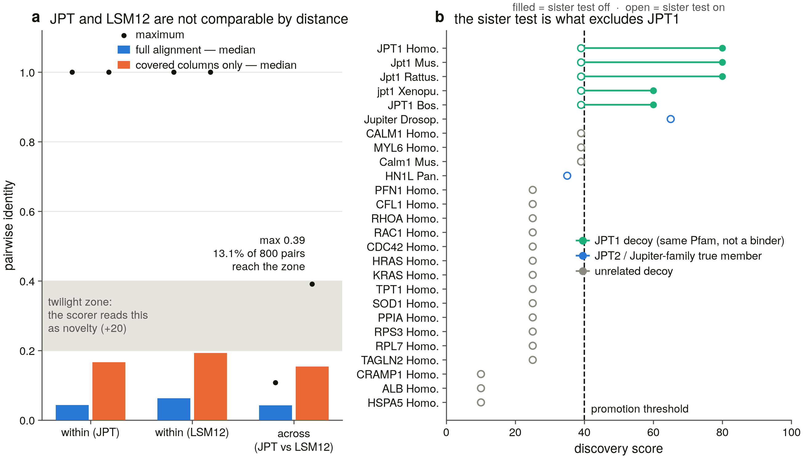

# S1 control benchmark — toolchain, partitioning, recall, specificity, and the JPT1 decoy

_Generated from the committed tables on 2026-08-18 19:41 · benchmark run 99.2 s · 17 positive + 58 decoy panel records over 57 unique accessions · promotion threshold score ≥ 40 · size band 120–280 aa._

**Headline.** The scorer is usable **only per partition**, and only with the family-signature fallback attached.

* **Specificity 58/58 (100 %)**, including 5/5 JPT1 decoys — but **only because of the sister-family test**. With it disabled, 5/5 JPT1 decoys are promoted, at 60–80, and specificity falls to 53/58.
* **Recall 12/15 (80 %)** when a true member arrives unnamed — every miss is a JPT2 ortholog that carries **no Pfam cross-reference** (D25). Attaching the MSA-derived family signature derived from the named members takes it to **15/15 (100 %)**.
* **Mixing the two families is harmless while each keeps a named member, and severe as soon as one does not.** Joint versus partitioned changed 1/57 scores with both families named, and 44/57 scores with 2 call flips when only JPT2 was named.
* **The labelled-bait margin cannot call the deep grade.** It is 20/20 correct on the vertebrate panel under the metric in use, but *Drosophila* Jupiter sits inside the D7 no-call band and is called the wrong way under the fragment-aware metric S6 adopts.

**Figure S1.** *(a)* Pairwise identity within each family and across the JPT/LSM12 boundary, from the joint alignment, under both metrics; the shaded band is the twilight zone the scorer credits with +20 for novelty. *(b)* Every JPT-partition record's score with the sister-family test on (open) and off (filled). The five JPT1 decoys are the only records the test moves.

## 1. Toolchain

| Tool | Version | Resolves via | Needed by |
|---|---|---|---|
| `mafft` | v7.526 | PATH | S1/S6 |
| `hmmbuild` | 3.4 | PATH | S3 |
| `hmmsearch` | 3.4 | PATH | S3 |
| `jackhmmer` | 3.4 | PATH | S3 |
| `blastp` | 2.16.0+ | env | S1/S5 |
| `tblastn` | 2.16.0+ | env | S5 |
| `makeblastdb` | 2.16.0+ | env | S5 |
| `miniprot` | 0.18-r281 | PATH | S5/S10 |
| `trimal` | v1.5.rev1 | PATH | S6 |
| `iqtree2` | 2.3.6 | PATH | S7 |
| `datasets` | 18.35.0 | env | S4 |
| `foldseek` | 10.941cd33 | env | S11 (opt) |

All 12/12 binaries resolve; full paths and Python package versions in `results/toolchain_manifest.txt`. Tools marked `env` live in the reused `piezo1` conda env rather than on the bare PATH (Decisions D18).

### MAFFT is really invoked

`analyse(use_mafft=True)` made 1 call(s) to `mafft --auto --quiet /dev/stdin` returning 0; 57 sequences aligned to 1,811 columns in the joint run, 1,400 in the JPT partition and 1,497 in the LSM12 partition. `src/analysis/alignment.py:_mafft` falls back to the star alignment **silently** on a non-zero return code, so the return code is the evidence, not the fact that a call happened. Trace: `mafft_trace.json`.

### One giant decoy is a panel-design bug for a 190 aa family

The first build of this panel included titin (Q8WZ42, 34,350 aa) as an out-of-band control. It inflates the JPT alignment from **1,400 to 34,359 columns** — a 25× increase for one added sequence. What it does *not* do is corrupt the identities: mean identity among true family members moves only from 0.4589 to 0.4473, because gap-gap columns are skipped. So the cost is runtime and memory, not accuracy — but at census scale it is prohibitive, and titin was replaced by bounded out-of-band decoys (CRAMP1 1,269 aa, ATXN2L 1,075 aa, HSPA5 654 aa, ALB 609 aa, LSM14A 463 aa, and the Sm proteins at 76–133 aa below the band). Table: `alignment_width_effect.tsv`. **The sibling projects never needed this rule** — their family members are 2,000–3,600 aa, so no decoy is two orders of magnitude longer than the subject.

### Ensembl, re-probed

The S0 emergent task asked for a re-probe before S1 depended on Ensembl. Re-run the same day: `/info/ping` 0.63 s; `lookup/symbol` 4/5 ok, mean 10.6 s (was 19.8 s); `xrefs/symbol` 3/5 ok with two 30 s timeouts. Zebrafish `lookup/symbol/danio_rerio/lsm12` still returns **HTTP 400** while `xrefs/symbol` on the same gene now succeeds — so that one is a symbol/ID-type problem, not an outage, and it survived the service recovering. **Ensembl is improved but still not dependable: S2/S3 must not take it as a required source.** Evidence: `ensembl_reprobe.tsv` next to S0's `ensembl_endpoint_probe.tsv`.

## 2. The partition (D14) — what mixing the families actually costs

`family.py:FAMILY_PARTITIONS` was declared at setup and **nothing read it** (D14a). S1 implements it: `utils/partitions.py` assigns every record to a family — provenance first, then family Pfam, then symbol — and `discover_novel_paralogs` now calls `assert_single_partition` on every run and **raises** on a mixed set. The route for a mixed set is `discovery/partition.py:run_partitioned_discovery`, which splits **before the alignment**: each family gets its own MSA, identity matrix and tree, so a cross-family number has nowhere to exist. `src/cli.py` routes any preset spanning both families through it. Assignment table: `partition_assignment.tsv` (0 records unassignable).

### How similar is a JPT2 to an LSM12?

| Metric | Pair class | n | Median | Max | In twilight zone |
|---|---|---|---|---|---|
| full alignment | across families (JPT vs LSM12) | 800 | 0.0427 | 0.1082 | 0 (0.0 %) |
| full alignment | within family (JPT) | 496 | 0.0430 | 1.0000 | 44 (8.9 %) |
| full alignment | within family (LSM12) | 300 | 0.0625 | 1.0000 | 26 (8.7 %) |
| covered columns only | across families (JPT vs LSM12) | 800 | 0.1538 | 0.3913 | 105 (13.1 %) |
| covered columns only | within family (JPT) | 496 | 0.1667 | 1.0000 | 116 (23.4 %) |
| covered columns only | within family (LSM12) | 300 | 0.1932 | 1.0000 | 121 (40.3 %) |

Two things follow, and they point in opposite directions.

**Under the metric the scorer uses today** (full-alignment identity), cross-family pairs top out at **0.1082** — below the 0.20 novelty floor, so **0.0 %** of them reach the twilight zone. The unrelated families are *too* unrelated to trip the novelty component.

**Under the fragment-aware metric S6 adopts** (`covered_only=True`), the same pairs reach **0.3913** and **105 of 800 (13.1 %)** land inside the zone — each one worth +20, which also satisfies the D3 promotion gate. **The switch S6 is already committed to would turn D14 from a tidiness rule into the thing standing between the census and a wave of manufactured novelty.** This is the same trap the sibling ITPR project measured on its sister family, and it is pre-registered here before the metric changes.

### The distortion, measured before the fix

| Comparison | records | scores differ | calls flip |
|---|---|---|---|
| joint vs partitioned, both families named | 57 | 1 | 0 |
| joint vs partitioned, true members unnamed | 57 | 2 | 0 |
| **joint vs partitioned, only JPT2 named** | 57 | **44** | **2** |

The roadmap predicted that with both families in one set *every* candidate would land in the twilight zone by construction. **That is not what happens, and the reason matters:** as long as each family keeps at least one named member, each candidate's nearest *known* paralog is a real relative and the joint run reproduces the partitioned one almost exactly. The failure appears the moment a family has **no named member** — the realistic case for the non-vertebrate sweep in S20. Then every LSM12 record is scored against human JPT2: 44 of 57 scores change and 2 calls flip (P38828, Q9VYR0 — yeast LSM12 and fly Lsm12a), each promoted on a +10 cluster-exclusion point earned against an unrelated protein. The partitioned run correctly withholds it and says so in the evidence.

So **D14 stands, with its justification restated**: the danger is not that unrelated proteins look novel, it is that the scorer will compute *some* number for any pair it is handed and cannot tell the difference between a distant relative and a stranger. Table: `crossfamily_identity.tsv`; per-record scores in `scores.tsv`.

**A scorer bug found on the way.** The outlier, cluster and sister components read `restrict=known_labels or None`, so an *empty* known set silently became "no restriction" and every candidate was scored against its nearest neighbour of any kind. That is the D24 failure class — a missing reference quietly becoming a different one — and it is exactly the state a partitioned run reaches when a family has no named member. Fixed in `discovery/candidates.py`; the components now decline to fire and record why.

## 3. Positive controls — recall

**The hold-out had to change.** The sibling projects hide one paralog name at a time and check its orthologs still surface; that works when a family has three members. Here each partition has exactly **one** binder member, so hiding it empties `known_paralogs` and the outlier, cluster and sister components have nothing to measure against — the hold-out would be disabling the scorer, not testing it. Instead the human reference keeps its name and every other true member enters wearing a locus-style ID (`LOC<accession>`), which is what an unannotated ortholog looks like coming out of a genome sweep. That is the real use case, and it leaves one named member per partition so the machinery still runs.

**Recall 12/15 (80 %)** with the signature set derived inside the anonymised run; **15/15 (100 %)** with the signature set carried from the named members, which is how production works. The two named references (Q9H910, Q3MHD2) are known members rather than candidates and are excluded from the denominator rather than counted as misses.

| Partition | Accession | Species | aa | family Pfams | Score | ≥40 | Score with signature set | Components |
|---|---|---|---|---|---|---|---|---|
| JPT | `Q9H910` JPT2 | Homo sapiens | 190 | 1 | n/a | ✗ | n/a | — |
| JPT | `Q6PGH2` Jpt2 | Mus musculus | 190 | 0 | 30 | ✗ | 45 | size+15,breadth+15 |
| JPT | `Q5BK20` Jpt2 | Rattus norvegicus | 190 | 0 | 30 | ✗ | 45 | size+15,breadth+15 |
| JPT | `A0A6I8PKV3` jpt2 | Xenopus tropicalis | 192 | 1 | 60 | ✓ | 60 | size+15,pfam+20,cluster+10,breadth+15 |
| JPT | `F1Q6E4` jpt2 | Danio rerio | 218 | 1 | 80 | ✓ | 80 | size+15,pfam+20,outlier+20,cluster+10,breadth+15 |
| JPT | `A0AAA9SSJ4` JPT2 | Bos taurus | 209 | 0 | 39 | ✗ | 55 | size+15,cluster+10,breadth+15,GATED→39 |
| JPT | `K7D4U4` HN1L | Pan troglodytes | 190 | 1 | 50 | ✓ | 50 | size+15,pfam+20,breadth+15 |
| JPT | `Q9I7K0` Jupiter | Drosophila melanogaster | 208 | 1 | 65 | ✓ | 65 | size+15,pfam+20,outlier+20,cluster+10 |
| LSM12 | `Q3MHD2` LSM12 | Homo sapiens | 195 | 2 | n/a | ✗ | n/a | — |
| LSM12 | `Q9D0R8` Lsm12 | Mus musculus | 195 | 2 | 50 | ✓ | 50 | size+15,pfam+20,breadth+15 |
| LSM12 | `A0A8I6GM11` Lsm12 | Rattus norvegicus | 195 | 2 | 50 | ✓ | 50 | size+15,pfam+20,breadth+15 |
| LSM12 | `Q5ZML5` LSM12 | Gallus gallus | 194 | 2 | 50 | ✓ | 50 | size+15,pfam+20,breadth+15 |
| LSM12 | `Q6P833` lsm12 | Xenopus tropicalis | 194 | 2 | 50 | ✓ | 50 | size+15,pfam+20,breadth+15 |
| LSM12 | `Q6PBA2` lsm12a | Danio rerio | 196 | 2 | 50 | ✓ | 50 | size+15,pfam+20,breadth+15 |
| LSM12 | `Q0VCF9` LSM12 | Bos taurus | 195 | 2 | 50 | ✓ | 50 | size+15,pfam+20,breadth+15 |
| LSM12 | `Q9VYR0` Lsm12a | Drosophila melanogaster | 217 | 2 | 65 | ✓ | 65 | size+15,pfam+20,outlier+20,cluster+10 |
| LSM12 | `P38828` LSM12 | Saccharomyces cerevisiae (strain ATCC 204508 / S288c) | 187 | 1 | 65 | ✓ | 65 | size+15,pfam+20,outlier+20,cluster+10 |

### Every miss is the same miss

All 3 recall failures are JPT2 orthologs — `Q6PGH2` Mus musculus, `Q5BK20` Rattus norvegicus, `A0AAA9SSJ4` Bos taurus — and every one of them carries **zero family Pfam cross-references** despite being a real JPT2. This is D25 arriving at the scorer: PF17054 annotates only 46.2 % of IPR033335, and reviewed mouse JPT2 (Q6PGH2) carries the InterPro family entry and no Pfam at all. Without the domain component they score 30–39 and are not promoted.

Attaching the MSA-derived family signature — 8 blocks, built from the *named* members of the same partition — rescues all of them via the `sig+15` fallback, and specificity does not move (58/58). **This is the S2-blocking question answered: `no Pfam` must not be read as `not in the family`, and the fallback is the mechanism that makes that safe.** Note the corollary — deriving the signature set *inside* an all-unnamed run yields one named row and no PSSM at all (0 blocks), so S2 must build the signature from the named reference panel and apply it to candidates, never derive it from the candidate set. `run_partitioned_discovery(signature_sets=…)` exists for exactly that.

### The LSM12 partition is the easy half

Every LSM12 positive scored 50 or better, including *Drosophila* Lsm12a (65) and *S. cerevisiae* LSM12 (65) — the deep grade, recovered because PF09793/PF21166 annotate their own InterPro entries essentially completely (0.998, 1.000 in S0). The asymmetry between the partitions is a property of the *annotation*, not of the proteins, and it is why the two partitions need different census denominators (D25).

## 4. Negative controls — specificity, and the decoy inside the family

**58/58 decoys stay below 40 in the partitioned runs — specificity 100 %.** The generic decoys are scored
once in each partition, so they appear twice. Top 20 by score:

| Partition | Decoy | Category | aa | in band | family Pfams | Score | Score without sister test | Pass | Components |
|---|---|---|---|---|---|---|---|---|---|
| JPT | `Q9UK76` JPT1 | JPT1 (sister paralog) | 154 | yes | 1 | 39 | 80 | ✓ | size+15,pfam+20,outlier+20,cluster+10,breadth+15,SISTER→39 |
| JPT | `P97825` Jpt1 | JPT1 (sister paralog) | 154 | yes | 1 | 39 | 80 | ✓ | size+15,pfam+20,outlier+20,cluster+10,breadth+15,SISTER→39 |
| JPT | `Q6AXU6` Jpt1 | JPT1 (sister paralog) | 149 | yes | 1 | 39 | 80 | ✓ | size+15,pfam+20,outlier+20,cluster+10,breadth+15,SISTER→39 |
| JPT | `I7KJP8` jpt1 | JPT1 (sister paralog) | 143 | yes | 0 | 39 | 60 | ✓ | size+15,outlier+20,cluster+10,breadth+15,SISTER→39 |
| JPT | `Q3T0T5` JPT1 | JPT1 (sister paralog) | 154 | yes | 0 | 39 | 60 | ✓ | size+15,outlier+20,cluster+10,breadth+15,SISTER→39 |
| JPT | `P0DP23` CALM1 | in-band unrelated | 149 | yes | 0 | 39 | 39 | ✓ | size+15,cluster+10,breadth+15,GATED→39 |
| JPT | `P60660` MYL6 | in-band unrelated | 151 | yes | 0 | 39 | 39 | ✓ | size+15,cluster+10,breadth+15,GATED→39 |
| JPT | `P0DP26` Calm1 | in-band unrelated | 149 | yes | 0 | 39 | 39 | ✓ | size+15,cluster+10,breadth+15,GATED→39 |
| LSM12 | `P0DP23` CALM1 | in-band unrelated | 149 | yes | 0 | 39 | 39 | ✓ | size+15,cluster+10,breadth+15,GATED→39 |
| LSM12 | `P60660` MYL6 | in-band unrelated | 151 | yes | 0 | 39 | 39 | ✓ | size+15,cluster+10,breadth+15,GATED→39 |
| LSM12 | `P0DP26` Calm1 | in-band unrelated | 149 | yes | 0 | 39 | 39 | ✓ | size+15,cluster+10,breadth+15,GATED→39 |
| JPT | `P07737` PFN1 | in-band unrelated | 140 | yes | 0 | 25 | 25 | ✓ | size+15,cluster+10 |
| JPT | `P23528` CFL1 | in-band unrelated | 166 | yes | 0 | 25 | 25 | ✓ | size+15,cluster+10 |
| JPT | `P61586` RHOA | in-band unrelated | 193 | yes | 0 | 25 | 25 | ✓ | size+15,cluster+10 |
| JPT | `P63000` RAC1 | in-band unrelated | 192 | yes | 0 | 25 | 25 | ✓ | size+15,cluster+10 |
| JPT | `P60953` CDC42 | in-band unrelated | 191 | yes | 0 | 25 | 25 | ✓ | size+15,cluster+10 |
| JPT | `P01112` HRAS | in-band unrelated | 189 | yes | 0 | 25 | 25 | ✓ | size+15,cluster+10 |
| JPT | `P01116` KRAS | in-band unrelated | 189 | yes | 0 | 25 | 25 | ✓ | size+15,cluster+10 |
| JPT | `P13693` TPT1 | in-band unrelated | 172 | yes | 0 | 25 | 25 | ✓ | size+15,cluster+10 |
| JPT | `P00441` SOD1 | in-band unrelated | 154 | yes | 0 | 25 | 25 | ✓ | size+15,cluster+10 |

### JPT1 — stated plainly, as the brief requires

All 5 JPT1 decoys carry the JPT2 size class and 3 of 5 carry PF17054 itself. **With the sister-family test disabled, every one of them is promoted** — at 80 for the three that hold the Pfam (`size+15,pfam+20,outlier+20,cluster+10,breadth+15`) and 60 for the two that do not — and specificity falls from 58/58 to 53/58. With it enabled, 5/5 are capped at 39 with the margin recorded.

So the answer to the brief's question is: **the JPT1 decoy fails any domain-based rule** — 5/5 promoted without a distance test — **and passes a positional one.** Three properties of that test matter:

* it is a **positive test on distances**, not a name filter — the candidate's own gene symbol is never consulted, so an unnamed JPT1 locus from a genome sweep is called the same way;
* the **length band is not part of the call** (D22) — it enters only as the size component;
* the margin is **recorded on every candidate**, so every exclusion is auditable.

This is D21 in operational form: a domain hit remains a family call, and what separates the binder from its paralog here is sequence distance to a labelled bait — not a signature, not a length, and not (yet) anything functional. **The census still has no functional test**; S17 is where one has to come from.

The Lsm/Sm fold set behaves differently and more easily: LSM1–8, SNRPD1–3 and SNRPE/F/G carry no LSM12 Pfam and sit at 76–139 aa, mostly below the band, so they never approach the threshold. **The LSM12 partition has no sister-family panel at all** — `family.py:SISTER_PARALOGS` names only JPT1/HN1 — so its specificity rests entirely on the domain component and the D3 evidence gate. If S2 or S20 turns up an LSM12-like protein that is not LSM12, there is currently no test that would catch it.

## 5. The JPT2/JPT1 labelled-bait margin (D7/D14)

| Class | n | identity to JPT2 bait | identity to JPT1 bait | margin | margin (fragment-aware) | calls correct |
|---|---|---|---|---|---|---|
| vertebrate JPT2 orthologs | 6 | 0.393–0.995 | 0.151–0.276 | +0.130…+0.752 | +0.071…+0.632 | 6/6 |
| deep grade (*Drosophila* Jupiter) | 1 | 0.215 | 0.174 | +0.041 | -0.015 | 1/1 (0/1 fragment-aware) |
| JPT1 decoys | 3 | 0.193–0.233 | 0.449–0.935 | -0.705…-0.256 | -0.614…-0.199 | 3/3 |

Overall 20/20 correct under the full-alignment metric and 18/20 under the fragment-aware one. The two classes separate cleanly on the vertebrate panel: the narrowest vertebrate-JPT2 margin is +0.130 (+0.071 fragment-aware) against a least-negative JPT1 margin of -0.256 (-0.199), a gap of 0.386 and 0.270 respectively. Two of the five JPT1 records are the labelled baits themselves and are excluded from the count.

**But the deep branch is not callable.** *Drosophila* Jupiter — a genuine Jupiter-family protein — has a margin of +0.041 on the full alignment and -0.015 under the fragment-aware metric, i.e. **inside the D7 no-call band both ways, and pointing at the wrong family under the metric S6 adopts.** It is not excluded (the test needs a margin beyond ±0.10 to act, and it correctly does nothing here), so Jupiter is promoted at 65 on domain evidence — but the margin contributes nothing to that call. And the vertebrate panel is not comfortable either: zebrafish `F1Q6E4` jpt2 has a margin of +0.071 under the fragment-aware metric — a true JPT2 also inside the D7 no-call band. **The labelled-bait margin is a vertebrate instrument.** For the non-vertebrate range question (S20) it must be replaced or supplemented by best-profile assignment (`jpt.hmm` vs a JPT1 decoy profile, S3), which is therefore not optional. Table: `bait_margin.tsv`.

*(The two bait accessions are marked `bait` and excluded from the correctness count: with a single JPT2 bait, its own identity to 'the nearest JPT2 bait' is 0 by construction and would score as a failure that means nothing.)*

## 6. The size component (D22) — measured, and kept

The band is 120–280 aa. Across the panel it contains **17/17 true family members and 40/58 decoys** — including every JPT1 (143–154 aa) alongside every JPT2 (190–218 aa), and every one of the 16 unrelated in-band proteins chosen precisely because they are 140–248 aa. The component therefore fires on almost the whole panel and separates nothing, exactly as D22 anticipated. The 18 decoys it does exclude are the deliberately out-of-band ones (CRAMP1, ATXN2L, HSPA5, ALB, LSM14A and the sub-100 aa Sm proteins), none of which was ever a plausible family member.

Recomputing every score with the component zeroed changes **7 of 133** promotion calls, and **all 7 of them are true positives lost** — no decoy call moves at all:

| Partition | Record | kind | score (size+15) | score (size+0) |
|---|---|---|---|---|
| JPT | `K7D4U4` HN1L | positive | 50 | 35 |
| LSM12 | `Q9D0R8` Lsm12 | positive | 50 | 35 |
| LSM12 | `A0A8I6GM11` Lsm12 | positive | 50 | 35 |
| LSM12 | `Q5ZML5` LSM12 | positive | 50 | 35 |
| LSM12 | `Q6P833` lsm12 | positive | 50 | 35 |
| LSM12 | `Q6PBA2` lsm12a | positive | 50 | 35 |
| LSM12 | `Q0VCF9` LSM12 | positive | 50 | 35 |

**Decision: retain the component at +15 for S2, and never quote the band as evidence.** The measurement says the component carries no discriminative information — but the 40-point threshold, the D3 evidence gate and the sister test were all calibrated with it in place, and the informative components alone (`pfam+20` + `breadth+15` = 35) fall below the threshold. Zeroing it without re-deriving the threshold trades a harmless constant for a real recall loss. What it is *not* is support for a family call: no report in this repo cites length as evidence, and the sister test deliberately excludes it. Re-weighting the scorer against a recalibrated threshold is logged as an emergent task rather than done silently. Table: `size_component.tsv`.

## 7. What this benchmark does not establish

* **No functional test exists.** Everything here separates JPT2 from JPT1 by sequence distance to a labelled bait. Nothing in this repo can yet say a protein binds NAADP (D21). S17 is where a sequence-level binder signature has to come from, if there is one.
* **The deep grade is called on domain evidence alone.** Fly Jupiter and yeast LSM12 are promoted by `pfam+20`; the distance components either abstain or point the wrong way. For S20's non-vertebrate sweep that is the whole population, so the profile route (S3) is load-bearing, not a cross-check.
* **Decoy provenance.** Every decoy enters as a named UniProt entry. A decoy arriving via Compara or BLAST gains the +10 homology-provenance component, so read every score in the 30–39 band as a 40+ risk on that route — that includes all five JPT1 decoys, which sit at exactly 39.
* **Unnamed sister-family loci.** The sister test needs at least one *labelled* JPT1 bait in the analysis set. Every search that expects JPT1 contamination must carry `src/utils/family.py:SISTER_PANEL` — S2 onward.
* **The LSM12 partition has no sister panel**, so nothing equivalent protects it.
* **Fold and split-annotation components never fired**: no Foldseek run and no split gene models in a UniProt-only panel. Their contribution is untested.
* **Five panel members did not resolve by symbol** — chicken JPT2 and JPT1, zebrafish jpt1, *C. elegans* lsm-12, *Arabidopsis* LSM12A. Given LSM12 resolves in chicken and zebrafish, these are more likely naming or annotation than absence; they are the S2 emergent task, and they are recorded in `panel_positives_missing.tsv` / `panel_decoys_missing.tsv` rather than omitted (D24).
* **One species per symbol, 57 accessions.** Breadth is measured on a panel, not on the census.
